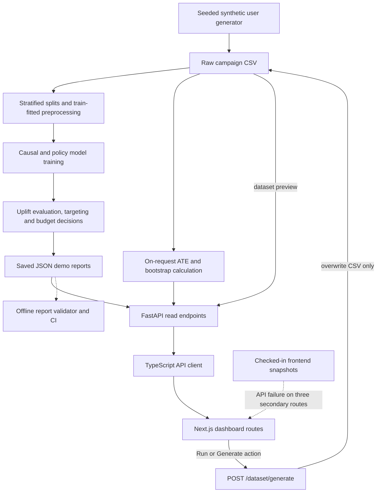

# PrimeLift Architecture

PrimeLift is a local-first prototype for analysing synthetic campaign data. This diagram maps the inspected source at commit `f24ff986c9c4a6c7f0f30eeafd632d7ae0a13dc4`; it is not a deployment or model-reproduction claim.

Solid arrows show implemented data dependencies or explicit application actions. The dotted validation path is an offline consistency check; it is not an API middleware or model-training stage. The application does not automatically execute the entire training pipeline when the dashboard runs.

## Pipeline and Artifact Boundaries

| Stage | Source and behaviour |
|---|---|
| Synthetic data | [generator.py](https://github.com/jyotheshkar/PrimeLift/blob/f24ff986c9c4a6c7f0f30eeafd632d7ae0a13dc4/backend/src/primelift/data/generator.py) creates seeded campaign users; defaults are 100,000 rows and seed 42. The data is synthetic, with conversion and revenue outcomes. |
| Preparation | [preparation.py](https://github.com/jyotheshkar/PrimeLift/blob/f24ff986c9c4a6c7f0f30eeafd632d7ae0a13dc4/backend/src/primelift/data/preparation.py) creates stratified 70/15/15 train/validation/test partitions. [preprocessing.py](https://github.com/jyotheshkar/PrimeLift/blob/f24ff986c9c4a6c7f0f30eeafd632d7ae0a13dc4/backend/src/primelift/features/preprocessing.py) fits imputers, scaling and categorical encoding on the training split and transforms the other splits. Prepared CSVs and a preprocessor artifact are written separately. |
| Causal models | [XLearner](https://github.com/jyotheshkar/PrimeLift/blob/f24ff986c9c4a6c7f0f30eeafd632d7ae0a13dc4/backend/src/primelift/causal/xlearner.py), [DRLearner](https://github.com/jyotheshkar/PrimeLift/blob/f24ff986c9c4a6c7f0f30eeafd632d7ae0a13dc4/backend/src/primelift/causal/drlearner.py) and [CausalForestDML](https://github.com/jyotheshkar/PrimeLift/blob/f24ff986c9c4a6c7f0f30eeafd632d7ae0a13dc4/backend/src/primelift/causal/causal_forest.py) train from prepared splits and write scored outputs and training/evaluation reports. These are separate offline workflows. |
| Policy models | [DRPolicyTree](https://github.com/jyotheshkar/PrimeLift/blob/f24ff986c9c4a6c7f0f30eeafd632d7ae0a13dc4/backend/src/primelift/decision/policy_tree.py) and [DRPolicyForest](https://github.com/jyotheshkar/PrimeLift/blob/f24ff986c9c4a6c7f0f30eeafd632d7ae0a13dc4/backend/src/primelift/decision/policy_forest.py) use split membership and raw campaign data to train treatment policies. This is distinct from the causal-effect learner comparison. |
| Evaluation and decisions | [model_comparison.py](https://github.com/jyotheshkar/PrimeLift/blob/f24ff986c9c4a6c7f0f30eeafd632d7ae0a13dc4/backend/src/primelift/evaluation/model_comparison.py), uplift decile/cohort modules, [model_targeting.py](https://github.com/jyotheshkar/PrimeLift/blob/f24ff986c9c4a6c7f0f30eeafd632d7ae0a13dc4/backend/src/primelift/decision/model_targeting.py), [budget_allocation.py](https://github.com/jyotheshkar/PrimeLift/blob/f24ff986c9c4a6c7f0f30eeafd632d7ae0a13dc4/backend/src/primelift/decision/budget_allocation.py) and [decision_closeout.py](https://github.com/jyotheshkar/PrimeLift/blob/f24ff986c9c4a6c7f0f30eeafd632d7ae0a13dc4/backend/src/primelift/decision/decision_closeout.py) produce saved comparison, targeting, budget and policy-closeout artifacts. Budget allocation is a recommendation calculation; it does not spend money or call an advertising provider. |
| Artifact locations | [paths.py](https://github.com/jyotheshkar/PrimeLift/blob/f24ff986c9c4a6c7f0f30eeafd632d7ae0a13dc4/backend/src/primelift/utils/paths.py) defines the raw/processed data, model, feature and metric paths. The checked-in JSON reports are saved demonstration outputs; their scores have not been regenerated for this document. |

Training and report-generation entrypoints live under [backend/scripts](https://github.com/jyotheshkar/PrimeLift/tree/f24ff986c9c4a6c7f0f30eeafd632d7ae0a13dc4/backend/scripts). They have upstream data/artifact dependencies and are separate from serving the API.

## Serving and Interface

[app.py](https://github.com/jyotheshkar/PrimeLift/blob/f24ff986c9c4a6c7f0f30eeafd632d7ae0a13dc4/backend/src/primelift/api/app.py) registers the FastAPI routes. [analysis.py](https://github.com/jyotheshkar/PrimeLift/blob/f24ff986c9c4a6c7f0f30eeafd632d7ae0a13dc4/backend/src/primelift/api/analysis.py) distinguishes calculations from reads:

| API path | Implemented behaviour |
|---|---|
| `GET /analysis/ate` | Loads the current raw CSV and calculates difference-in-means ATE with bootstrap intervals for the requested outcome. |
| `GET /analysis/models` | Loads the saved Phase 3 model-comparison JSON. |
| `GET /analysis/segments` | Loads saved Phase 4 decile, cohort-rollup and validation-summary JSON. |
| `GET /analysis/recommendations` | Loads saved Phase 5 decision-closeout JSON. |
| `GET /dataset/sample` | Reads a preview of the current saved CSV. |
| `POST /dataset/generate` | Generates and overwrites the raw CSV; it does not retrain models or refresh saved reports. |

The [TypeScript client](https://github.com/jyotheshkar/PrimeLift/blob/f24ff986c9c4a6c7f0f30eeafd632d7ae0a13dc4/frontend/src/lib/primelift-api.ts) uses `NEXT_PUBLIC_PRIMELIFT_API_URL`, defaulting to `http://127.0.0.1:8001`. The root [PrimeDashboard](https://github.com/jyotheshkar/PrimeLift/blob/f24ff986c9c4a6c7f0f30eeafd632d7ae0a13dc4/frontend/src/components/prime-dashboard.tsx) starts idle; its Run action generates the CSV and then fetches ATE and saved reports. Failure produces an error state. The uplift-insights, recommendations and dataset-models components attempt API reads and fall back to checked-in frontend snapshots on failure. A successful API read of a saved report does not imply fresh model execution.

## Verification and Current Limitations

- [validate_demo_artifacts.py](https://github.com/jyotheshkar/PrimeLift/blob/f24ff986c9c4a6c7f0f30eeafd632d7ae0a13dc4/scripts/validate_demo_artifacts.py) reads six saved JSON reports and checks finite values, model/split identities, deciles, and budget/closeout consistency. The [CI workflow](https://github.com/jyotheshkar/PrimeLift/blob/f24ff986c9c4a6c7f0f30eeafd632d7ae0a13dc4/.github/workflows/demo-artifacts.yml) runs that offline check and Python syntax compilation. It does not invoke dataset generation, train a model, test the API/UI, bind a newly generated CSV to the old reports, or validate causal assumptions.
- Model comparison currently defaults to the split named `test` when selecting a champion. Later reports reuse that split. These exploratory selections are not an untouched final evaluation; the architecture diagram does not resolve that limitation.
- Changing the generated CSV's rows or seed can leave the live ATE/preview based on new data while model, cohort and recommendation endpoints still serve older artifacts. No automatic retraining or end-to-end artifact-lineage guarantee is implemented here.
- The API has no authentication and uses wildcard CORS. Dataset generation writes files; its request [schema](https://github.com/jyotheshkar/PrimeLift/blob/f24ff986c9c4a6c7f0f30eeafd632d7ae0a13dc4/backend/src/primelift/api/schemas.py) checks `rows > 0` but has no upper bound. This document adds no row cap, resource-budget enforcement, access control or safe public-hosting claim.
- All data and policy results are synthetic-demo evidence. No real-client impact, campaign execution, external provider write, current deployment, latency, cost or reproduced model score is claimed.

This documentation change was checked against the cited source files. No model training, data generation, API request, deployment or additional runtime test was performed.
