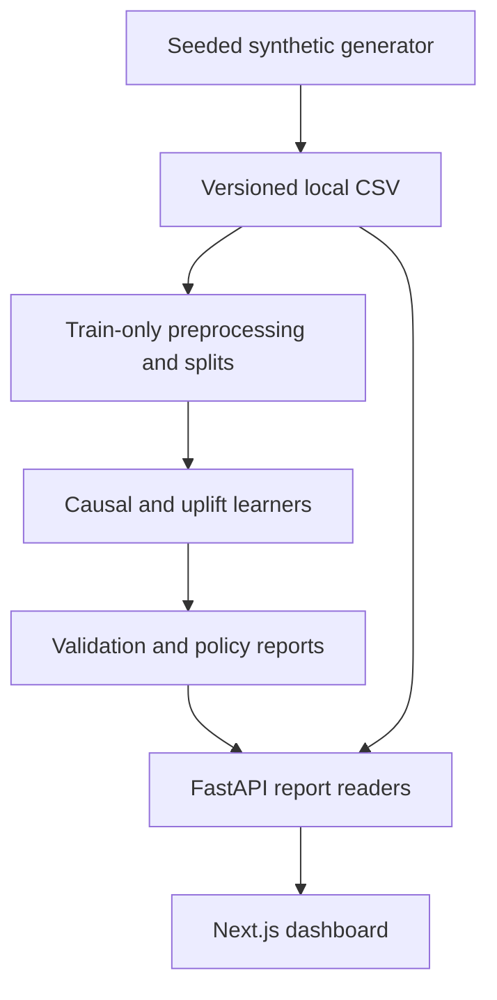

# PrimeLift causal-analysis architecture

Maintenance review: **11 November 2026**. Inspected base commit: `0958018baa93ba87f072a92e29c6a1b60cc950c0`.

Local-first causal decision-support prototype using synthetic campaign users. Saved reports are experiment artifacts, not evidence of real customer lift.

## Current implementation

| Source boundary | Responsibility and implementation status |
| --- | --- |
| `backend/src/primelift/data` | Dataset generator, summary and model-ready splits. |
| `backend/src/primelift/causal; uplift; decision` | ATE, CATE and policy comparison computations. |
| `backend/src/primelift/utils/paths.py` | Central artifact locations under the repository. |
| `backend/src/primelift/api; frontend/src/lib/primelift-api.ts` | Typed API contracts and live-dashboard adapter. |

## Changes in this maintenance pass

The synchronous dataset endpoint now rejects requests over 100,000 rows before expensive generation. CSV publication writes and flushes a sibling temporary file, then uses `os.replace`; a failed export leaves the previous complete CSV in place. Temporary files are cleaned on failure. The 100k ceiling is a protective demo limit, not a throughput benchmark.

## Verification and repeatable checks

`PYTHONPATH=backend/src python -m pytest backend/tests/test_dataset.py backend/tests/test_atomic_dataset.py backend/tests/test_api_dataset_generate.py backend/tests/test_api_dataset_sample.py backend/tests/test_api_health.py -q`. The new workflow runs this focused foundation suite; existing artifact validation remains separate.

Record the exact commit and hosted workflow result when reviewing a change. Passing a focused regression does not establish end-to-end reliability or measured capacity.

## Scale and ownership decisions

These are explicit **future design steps**, not implemented infrastructure or measured capacity claims.

| Pressure or boundary | Decision and next evidence |
| --- | --- |
| Generation | Use asynchronous jobs with per-job immutable dataset paths, quotas and cancellation before accepting larger requests. |
| Artifacts | Publish a manifest linking dataset hash, split seed, feature contract, model and report versions; avoid silently serving stale combinations. |
| Serving | Separate read-only report serving from training workers. Measure memory during training and API latency before setting worker counts. |

Keep one owner for each data contract, centralize paths/configuration, and review dependency changes with the smallest relevant regression suite. Separate computed results from static fixtures; version inputs with artifacts. Before release, reproduce setup from a clean checkout and check both failure paths and resource cleanup.

## Operational limits and recovery

CSV writers remain last-writer-wins; there is no durable background job queue, cross-process lock or dataset-to-model invalidation transaction. Full model-training and causal validity checks are outside the focused dataset regression suite.

Keep a known-good commit and backup mutable experiment artifacts before running migrations or training. On failure, preserve the error and input/configuration version; restore the prior artifact set or checkout the known-good code before retrying. No cloud deployment, paid service provisioning, data migration or production-scale load test was performed by this maintenance pass.
